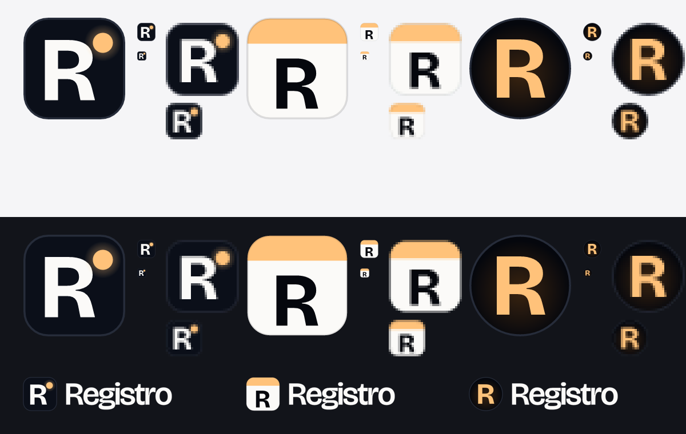

# Registro logo

Chosen: **A, live dot.** A night tile, the R from Bricolage Grotesque (the site's display face), and one ember light that's on. It says something is happening right now, uses the product's only accent colour, and reads at 16 px on light and dark browser tabs.

Top half on a light background, bottom half on dark. Each mark at 180 px, then 32 and 16 px at true size and zoomed.

- **A, live dot.** Chosen. Clear at every size, and the only mark with an idea in it.
- **B, date badge.** Echoes the date badge on every poster. Very legible, but reads as a generic calendar app.
- **C, glow.** Warm nightlife feel, but the dark circle nearly disappears on dark tab bars.

Files in use: `frontend/src/app/favicon.ico` (16, 32, 48 px), `frontend/src/app/icon.svg`, `frontend/src/app/apple-icon.png` (180 px, full bleed because iOS rounds the corners itself), and `frontend/src/components/Logo.tsx`. Brand files for slides and docs: `frontend/public/brand/`.

The R is drawn from Bricolage Grotesque, licensed under the SIL Open Font License, which allows using its letterforms in a logo.
