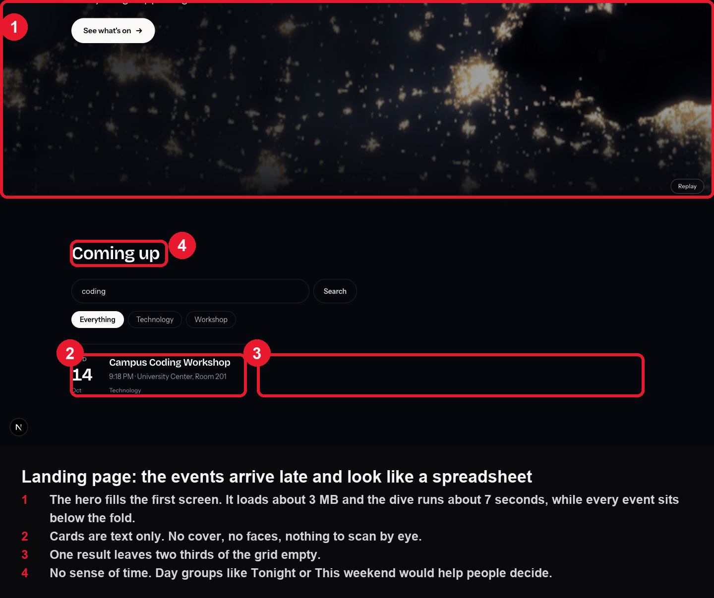
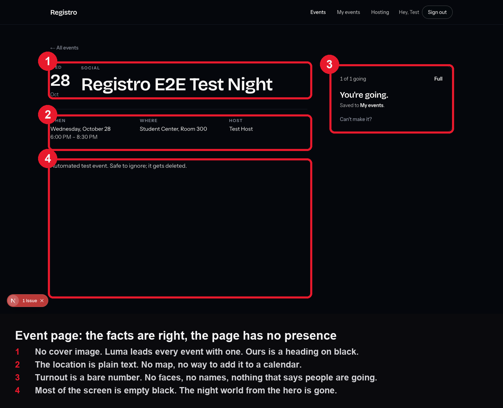
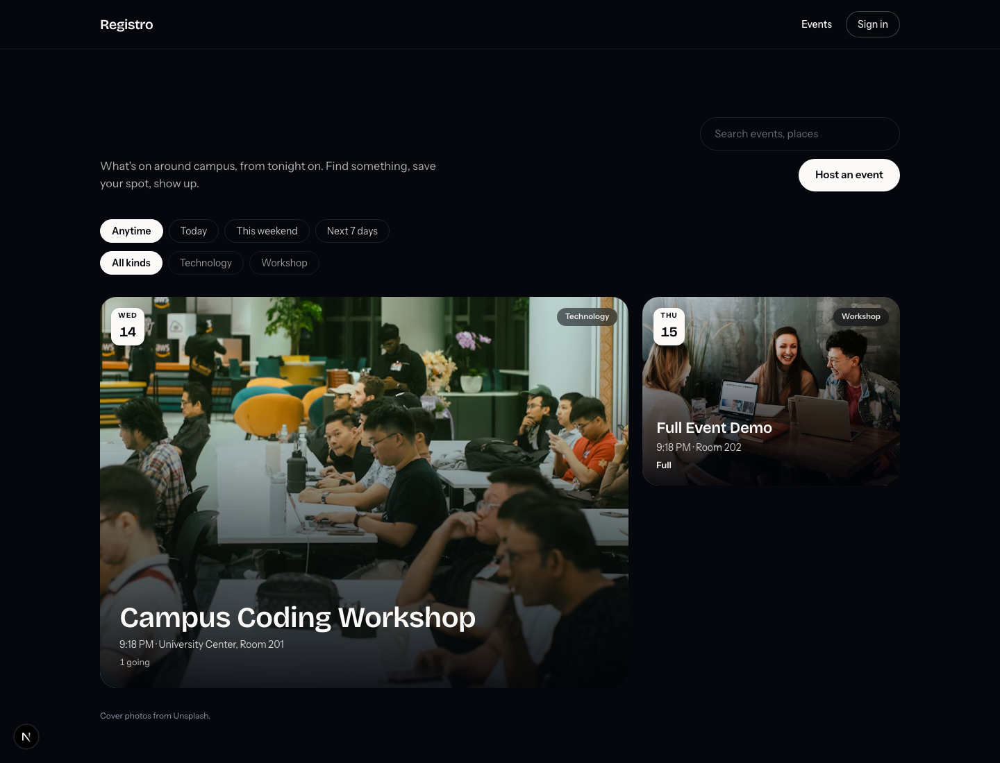
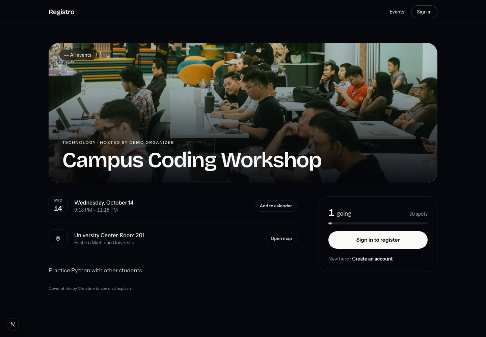
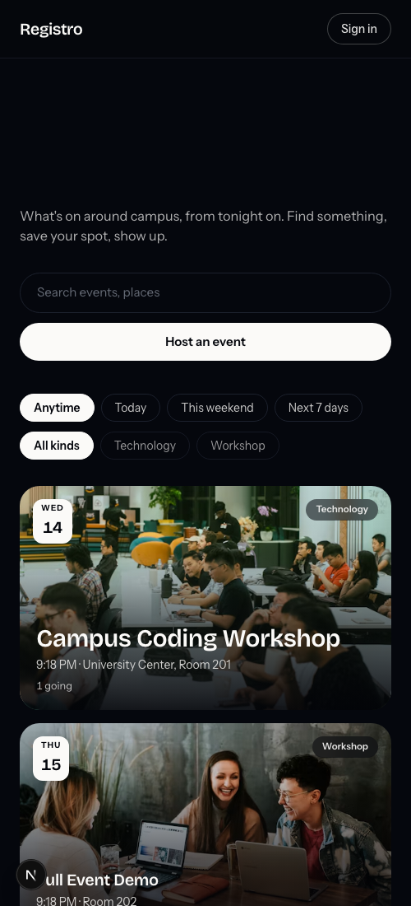
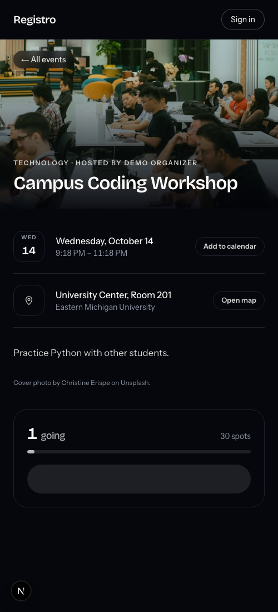

# Notes — Registro app renovation

Running log. Pair before/after by base name. Plain English, no dashes.

Template:

## NN — Screen name (before | after)

- Screen / context:
- Problem (before) / Change (after):
- Why it matters:
- Prototype: prototypes/xx.html
- Tags: #ia #ux #visual #before #after

---

## 01 — Whole app (before)

Context. Registro works end to end: browse, register, My events, hosting, sign in. Kobby's verdict on 2026-10-12: the landing page does not render well and the app does not feel good enough next to Luma.

Problems.
1. The landing page spends its first screen on the dive. It loads about 3 MB of imagery plus three.js, then plays for about 7 seconds. Every real event sits below the fold.
2. The laptop it is demoed on has 8 GB of RAM and was down to 65 MB free, swapping heavily. The integrated GPU shares that memory, so the dive stutters and the whole browser slows.
3. After the hero, the brand world disappears. Event page, My events and Hosting are grey text on black with no imagery.
4. Event cards are text only. Luma leads every event with a cover; ours cannot be scanned by eye.
5. Pages stack everything on the left and leave the right half empty.
6. The list has no sense of time. Nothing says Tonight or This weekend.
7. The event page has no map link, no add to calendar, and shows turnout as a bare number.

What Luma does that we should borrow. A cover on every event, with ready made covers for hosts who have none. Turnout shown as people. A host block. A map link. One clear registration panel. Discovery by category and by organizer.

Where we can do better than Luma. Their discover page is a flat list with no dates. Ours can group by time, which is how students actually decide. Our covers can come from the same real night imagery as the hero, so every event belongs to one world instead of a generic gradient.

## 02 — Direction chosen

Kobby picked C, the poster wall, with one change: "we can find so many images, why just that". Night-map covers became real photography.

Cover library. 40 photos hand-picked from Unsplash across nine sets: music, social, culture and food, sports, tech, career, study, arts, community. Every one was checked as free under the Unsplash License (paid Unsplash+ photos were filtered out by their refused download). Shots centred on alcohol were left out for a campus app. Images load from Unsplash's own CDN at the size each screen needs, so the repo gains no image files.

## 03 — Whole app (after)

Landing. The dive is gone from the landing page; the first screen is now your lines in big type, search, time and category filters, and the wall. The soonest event is a large poster, the rest fill a three column grid. Each poster has a date badge, the category, title, time and place, and turnout or spots left.

Time filters. Anytime, Today, This weekend, Next 7 days, all computed in campus time and tested for every day of the week.

Event page. The cover is the page's header with the title on its foot. Date and place each get one action next to them: Add to calendar (a standard .ics file) and Open map. On a phone the register panel comes straight after the cover. Turnout shows as a number with a fill bar that turns ember when spots run low.

Hosting. The create form has a cover picker that opens on the set matching the category typed, and what it previews is exactly what gets saved. The hosting list shows each event's cover.

My events. Posters instead of text rows.

Verified. Typecheck, lint and production build pass. Picking a cover, saving, and seeing it on the manage page was tested end to end with a throwaway account, then deleted.

Not done. Hosts cannot upload their own photo yet. That needs a storage bucket on the Supabase project, which only Mohamed can create.
