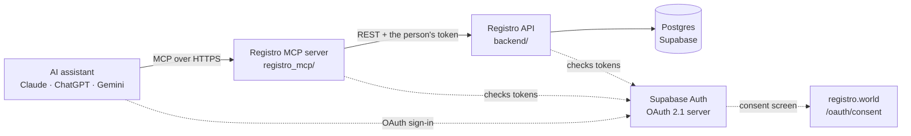
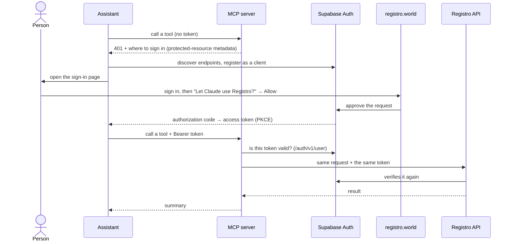

# Registro MCP server: architecture

## Goal

Let a person use Registro through an AI assistant instead of the website: "find me a technology event this week and register me for it". The assistant has to be able to search and read events, see what the person is registered for, and register them, always as that person and under the same rules as the website.

## Where it sits

The MCP server is a thin adapter. It holds no data, has no database access and no admin keys. Every tool calls the existing Registro API with the signed-in person's own token.

That was the main design decision, and it has three consequences:

- **One set of rules.** Capacity, double registration, drafts and events that already started are all enforced by the API, so an assistant can't do anything the website wouldn't let the person do.
- **Least privilege.** If the MCP server leaked its configuration, it would expose nothing; it only holds public values.
- **No drift.** When the team changes a rule in the API, the assistant follows automatically.

## The protocol, briefly

MCP (Model Context Protocol) is a standard way for an AI app to discover and call functions in another service. The server publishes a list of **tools**, each with a name, a description and a JSON Schema for its inputs. The model reads the list, chooses a tool for what the person asked, and calls it. The server returns the result, and the model turns it into an answer.

This server uses the official Python SDK (`mcp` 2.x). A tool is a typed Python function:

- The function's name becomes the tool name.
- Its docstring is the description the model reads to decide when to use it.
- Its type hints become the input schema. `when: Literal["today", "this_week", "upcoming"]` becomes a fixed list of choices, so a bad value is rejected before any code runs.

## Tools

| Tool | API call | Kind |
|---|---|---|
| `search_events(query, category, when)` | `GET /api/events` | read |
| `list_upcoming_events(days, limit)` | `GET /api/events?date_from&date_to` | read |
| `get_event_details(event_id)` | `GET /api/events/{id}` | read |
| `list_my_events(include_past)` | `GET /api/users/my-events` | read, as the person |
| `register_for_event(event_id)` | `POST /api/events/{id}/register` | write, as the person |
| `cancel_registration(event_id)` | `DELETE /api/events/{id}/register` | write, as the person |

Design choices in the tools:

- **Summaries, not raw rows.** Each event is cut down to the fields a conversation needs: title, time, place, spots left and a link. Less text for the model to read means fewer mistakes, and no internal IDs or organizer data leak into chat.
- **Hints for the assistant.** Each tool declares whether it is read-only or destructive (`ToolAnnotations`). Assistants use this to decide when to ask the person before acting; `cancel_registration` is marked destructive.
- **Confirm before acting.** The server's instructions, and the write tools' descriptions, tell the model to confirm the exact event with the person before registering or cancelling.
- **Errors as sentences.** The API's error codes (`EVENT_FULL`, `ALREADY_REGISTERED`, …) are turned into plain sentences ("That event is full."), so the assistant can pass them on instead of guessing.
- **`cancel_registration`** is beyond the proposal. It was added so that a registration made by mistake can be undone the same way it was made.

## Sign-in

Registering has to happen as the person, so the assistant needs that person's sign-in. The MCP specification uses **OAuth 2.1**: the MCP server is a *resource server*, and a separate *authorization server* signs people in and issues tokens.

Registro already signs people in with Supabase Auth, and Supabase can act as an OAuth 2.1 authorization server. So there is no second account system; assistants sign in as existing Registro users.

What each part does:

- **MCP server** (`auth.py`, `server.py`): answers unauthenticated calls with `401` and a `WWW-Authenticate` header pointing to `/.well-known/oauth-protected-resource/mcp`. That document names Supabase as the authorization server. Every token is checked with Supabase before a tool runs, and the result is cached for 60 seconds so a conversation doesn't re-check on every call.
- **Supabase**: handles discovery, dynamic client registration, the authorization code flow with PKCE, and refresh tokens.
- **Consent screen** (`frontend/src/app/(auth)/oauth/`): requires a signed-in person, shows which app is asking, what it will be able to do and where it will return to, and records Allow or Don't allow. The decision handler refuses cross-site posts, so another site can't approve on someone's behalf.
- **Registro API**: verifies the token again on every request. It does not trust the MCP server's check.

## Transports

- **Hosted (`app`)**: Streamable HTTP, **stateless**, with JSON responses. A serverless host may answer each request from a fresh instance, so no session state lives in memory. Host-header checking guards against DNS rebinding.
- **Local (`python server.py`)**: stdio, for the MCP Inspector and Claude Desktop. There is no sign-in screen, so a token can be supplied through `REGISTRO_ACCESS_TOKEN`.

## Testing

`pytest` runs 14 tests without touching real services. The Registro API and Supabase are replaced by fake HTTP transports.

- **Tool tests** drive the server through a real MCP client in the same process. They check the tool list and hints, how filters reach the API, the summaries, input validation, the sign-in requirement for personal tools, that registration forwards the person's token, and that errors read as plain sentences.
- **Hosted tests** run the HTTP app. They check the protected-resource metadata, rejection of missing or forged tokens, that a signed-in call reaches the API as that person, and that requests for another host are refused.

## Limits and next steps

- **Token audience.** Supabase tokens are issued to Registro users, not to this server specifically (`aud: authenticated`), so the server checks the person rather than the audience. A custom access-token hook could bind tokens to the MCP server's URL.
- **Search quality.** Search is the API's keyword match. "Something fun with music" depends on the model choosing good keywords and categories.
- **Rate limiting.** There is none at the MCP layer yet. The API and Supabase limits apply.
